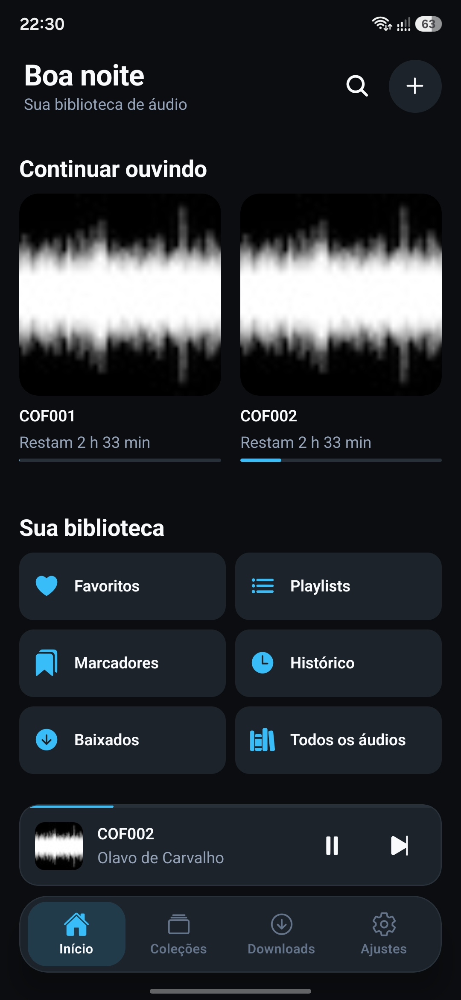
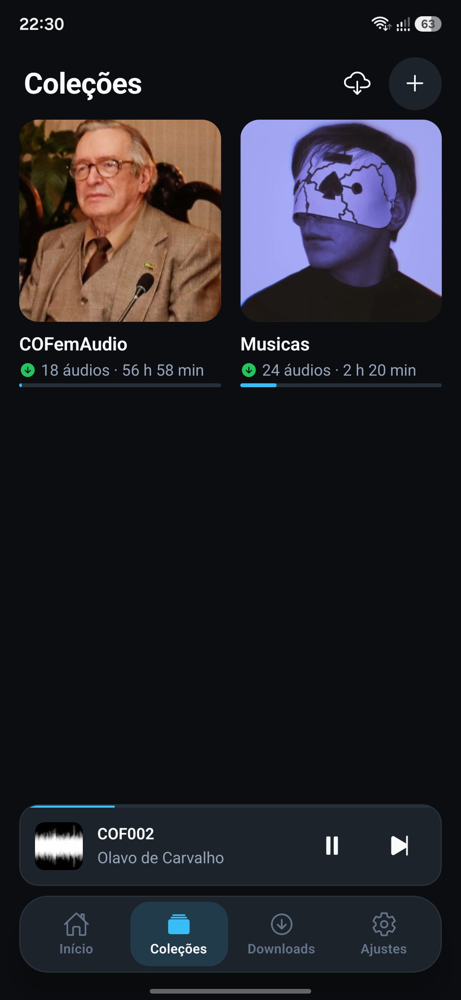
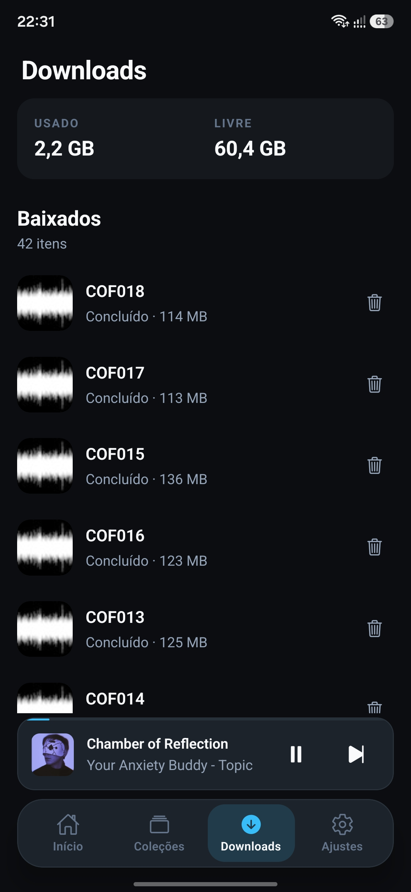

# Excultus

<p align="center">
  
</p>

<p align="center">
  <a href="https://zapstore.dev/app/com.excultus">Get it on Zapstore</a> ·
  <a href="https://github.com/misesdev/Excultus/releases/latest">Download the APK</a>
</p>

Open-source Android app to import, organize, download and listen to audio content: courses,
audiobooks, podcasts and music. It is **offline-first**: no account, no backend, no analytics.
Everything stays on your device.

Built with React Native CLI (**no Expo**), the new architecture (TurboModules) and strict
TypeScript.

> The interface is available in **English** and **Portuguese**. It follows the device
> language (English when it isn't supported) and can be changed under Settings → Language.

## Screenshots

<p align="center">
  
  
  
  
</p>

## Features

- **Import**
  - items from the **Internet Archive** (e.g. `https://archive.org/details/COFemAudio`);
  - direct audio links;
  - files from the device;
  - **YouTube** videos and playlists: the audio is downloaded as M4A, and the app tells you
    when a video can't be downloaded (it never saves a bare link).
- **Persistent downloads**
  - queue with configurable concurrency, pause and resume via HTTP Range, and retries with
    backoff;
  - integrity checks (size and MD5) and disk space control.
- **Background player**
  - media notification, lock screen and headset controls;
  - playback speed, skip, repeat and shuffle, queue, sleep timer, bookmarks and resume where
    you left off;
  - audio that can't play right now (no file or no connection) is skipped automatically.
- **Organization:** collections, playlists, favorites, history, full-text search (SQLite FTS5),
  filters and sorting.
- **Maintenance:** JSON backup and restore, storage verification and cleanup.
- **Languages:** English and Portuguese, following the device language or the choice in
  Settings.

## Stack

| Area | Technology |
|---|---|
| App | React Native 0.88, React 19, TypeScript, React Navigation 7 |
| State and forms | Zustand, React Hook Form + Zod |
| Database | SQLite via `@op-engineering/op-sqlite` (FTS5, versioned migrations) |
| Audio | `react-native-track-player` (with patches in `patches/`) |
| Native (Kotlin) | OkHttp downloader (chunked downloads and fragmented MP4 remuxing); YouTube resolution with [NewPipeExtractor](https://github.com/TeamNewPipe/NewPipeExtractor) |
| Tests | Jest, React Native Testing Library, real SQLite on Node, Maestro (E2E) |

## Requirements

| Tool | Version |
|---|---|
| Node.js | 22.22+ (`.nvmrc`); RN 0.88 requires ≥ 22.11 |
| JDK | A **full** JDK 17 or 21 (with `javac`), e.g. Android Studio's JBR |
| Android SDK | Platform 36, Build-Tools 36, NDK 27.1.12297006 |
| Device | Android 7.0+ (minSdk 24) |

> If the system's default Java is only a JRE, Gradle fails with a toolchain error about a
> missing `JAVA_COMPILER`. Pin the JDK in `~/.gradle/gradle.properties`:
>
> ```properties
> org.gradle.java.home=/path/to/jdk
> org.gradle.java.installations.auto-detect=false
> org.gradle.java.installations.paths=/path/to/jdk
> ```
>
> Then run `cd android && ./gradlew --stop`.

## Getting started

```bash
nvm use            # Node 22
npm install        # also applies patches/ (patch-package on postinstall)
npm start          # Metro
npm run android    # debug build, installed on the emulator or device
```

## Scripts

| Script | What it does |
|---|---|
| `npm run validate` | typecheck, lint and tests |
| `npm run typecheck` | `tsc --noEmit` (strict) |
| `npm run lint` | ESLint, including layer-boundary rules |
| `npm test` / `npm run test:coverage` | Jest (unit, SQLite integration and component tests) |
| `npm run e2e` / `npm run e2e:offline` | Maestro flows (see [`docs/testing.md`](docs/testing.md)) |
| `npm run android:release` | Release APK |
| `npm run zapstore:check` / `npm run zapstore:publish` | Check / publish the release on Zapstore (requires `zsp`) |

Git hooks (Husky): `pre-commit` runs lint-staged and typecheck; `pre-push` runs the tests.

## Release build (APK and AAB)

Releases are signed with a key that **never goes into the repository**. Create your own:

```bash
keytool -genkeypair -v -storetype PKCS12 -keystore ~/.android/excultus-release.jks \
  -alias excultus -keyalg RSA -keysize 4096 -validity 10000
```

Then set its path and passwords in `~/.gradle/gradle.properties`, outside the project:

```properties
EXCULTUS_RELEASE_STORE_FILE=/home/<you>/.android/excultus-release.jks
EXCULTUS_RELEASE_STORE_PASSWORD=...
EXCULTUS_RELEASE_KEY_ALIAS=excultus
EXCULTUS_RELEASE_KEY_PASSWORD=...
```

To build the APK and the AAB:

```bash
cd android && ./gradlew assembleRelease bundleRelease
# APK: android/app/build/outputs/apk/release/app-release.apk    (direct install)
# AAB: android/app/build/outputs/bundle/release/app-release.aab  (Play Store)
```

- **Without these properties** the build falls back to the debug key and logs a warning. That
  output is not publishable.
- **Back up** the keystore and its passwords. Without them you can't publish updates.
- **New version:** increment `versionCode` and set `versionName` in
  `android/app/build.gradle`, use the same version in `package.json`, and record the changes in
  [`CHANGELOG.md`](CHANGELOG.md).
- **Switching from debug to release:** an installed debug build has a different signature, so it
  must be uninstalled before installing the release on the same device, which wipes local data.

## Publishing on Zapstore

The app is distributed on [Zapstore](https://zapstore.dev), a decentralized Android app store
built on Nostr, configured in [`zapstore.yaml`](zapstore.yaml). On every push to `main` with a
new version, the [`release.yml`](.github/workflows/release.yml) workflow:

1. builds the signed APK;
2. creates the GitHub Release `v<version>` with the notes from `CHANGELOG.md`;
3. publishes to Zapstore with [`zsp`](https://github.com/zapstore/zsp).

To publish manually: `npm run zapstore:check`, then `npm run zapstore:publish`. Required
secrets, linking the signing key to your Nostr identity, and the step-by-step guide are in
[`docs/zapstore.md`](docs/zapstore.md).

## App icon

The original artwork is `AppIcon.png`. Every icon is generated from it by
`python3 scripts/app-icon/generate.py` (requires Pillow):

- Android adaptive icon (foreground, background and monochrome layers), with the symbol inside
  the safe zone so no mask clips it;
- legacy icons for Android 7;
- Play Store and iOS icons;
- white media notification icon.

To change the icon, replace `AppIcon.png` and run the script.

## Project structure

```text
src/
├── app/            composition root (DI), bootstrap, navigation, providers
├── core/           typed errors, shared ports, i18n catalogs (en, pt), pure utilities
├── design-system/  tokens, theme, icons, typography, animations and App* components
├── features/       audios, collections, downloads, imports, player, playlists, bookmarks,
│                   history, search, settings (+ library and home: UI composition)
├── infrastructure/ SQLite, file system, HTTP, external sources (Archive, YouTube),
│                   audio, downloader
└── shared/         presentation hooks, forms, feedback (toast/snackbar)
specs/              TurboModule specs (codegen): downloader and YouTube
android/app/src/main/java/com/excultus/
├── downloads/      OkHttp downloader and fragmented MP4 remuxing
└── youtube/        video and playlist resolution with NewPipeExtractor
scripts/app-icon/   icon generator
store/screenshots/  store screenshots
test/               fixtures, fakes and test support
e2e/flows/          Maestro flows
```

Clean architecture organized by feature: the domain and application layers know nothing about
React Native, and platform dependencies come in through ports and adapters. Details in
[`docs/architecture.md`](docs/architecture.md); decisions in
[`docs/decisions/`](docs/decisions).

## Documentation

The technical docs below are written in Portuguese.

- [Architecture](docs/architecture.md) · [Design system](docs/design-system.md) · [Database](docs/database.md)
- [Player](docs/audio-player.md) · [Downloads](docs/downloads.md) · [External sources](docs/external-sources.md)
- [Testing](docs/testing.md) · [Plan](docs/implementation-plan.md) · [Progress](docs/progress.md) · [Known issues](docs/known-issues.md)
- [Internationalization (ADR 0007)](docs/decisions/0007-internacionalizacao.md)

In English: [Publishing on Zapstore](docs/zapstore.md) · [Changelog](CHANGELOG.md)

## Privacy

- **Network:** the app only talks to the sources you import from. No analytics, no account.
- **Storage:** files are kept in the app's private directories.
- **Device files:** come in through the system picker (SAF), without broad storage permissions.

## Responsible use

Excultus is a tool for building your personal library. Only download content you have the right
to use, and respect each source's terms of service, including YouTube's. YouTube extraction
relies on NewPipeExtractor and may stop working when the site changes, until the library is
updated.

## Contributing

Issues and pull requests are welcome. Before opening a PR:

1. run `npm run validate` (typecheck, lint and tests must pass);
2. cover new behavior with tests;
3. record relevant architecture decisions in `docs/decisions/`.

## License

Copyright © 2026 Mises Dev

This program is free software: you can redistribute it and/or modify it under the terms of the
**GNU General Public License** as published by the Free Software Foundation, either version 3
of the License, or (at your option) any later version (**GPL-3.0-or-later**). It is distributed
in the hope that it will be useful, but **WITHOUT ANY WARRANTY**. See [`LICENSE`](LICENSE) for
the full text.

GPLv3 is required because the app includes
[NewPipeExtractor](https://github.com/TeamNewPipe/NewPipeExtractor), which is licensed under
GPLv3. All other dependencies use compatible licenses (MIT, Apache-2.0 and similar).
